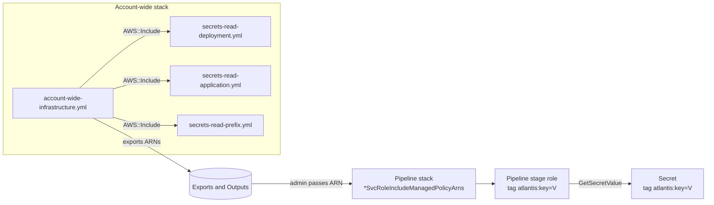

# Design Document

## Overview

This feature adds three account-wide, read-only IAM managed policies to `templates/v2/account/account-wide-infrastructure.yml`. Each policy lets a pipeline stage role call `secretsmanager:GetSecretValue` and `secretsmanager:DescribeSecret` on secrets whose `atlantis:*` tag value equals the same tag on the calling role. The three policies differ only in the tag key they compare:

| Level | Module file | Tag key | Logical ID |
|-------|-------------|---------|------------|
| Deployment | `secrets-read-deployment.yml` | `atlantis:ApplicationDeploymentId` | `SecretsReadDeploymentPolicy` |
| Application | `secrets-read-application.yml` | `atlantis:Application` | `SecretsReadApplicationPolicy` |
| Prefix | `secrets-read-prefix.yml` | `atlantis:Prefix` | `SecretsReadPrefixPolicy` |

All module files live in `templates/v2/modules/pipeline-policies/`. The work is additive: three `AWS::Include` resources, six outputs (three exported), a header comment and date change in the Account_Wide_Template, three new module files, one new test file, and documentation. No pipeline template and no pipeline module changes (Requirement 7.1). No new parameters, so the `AWS::CloudFormation::Interface` metadata does not change.

The design follows `codebuild-crud.yml` and `cognito-crud.yml` for structure, naming, and `Path`, and the module standards in `.kiro/steering/template-module-standards.md`.

## Verified AWS Behavior

The condition-key behavior was checked against the AWS documentation on 2026-11-12. Content was rephrased for compliance with licensing restrictions.

| Question | Finding | Source |
|----------|---------|--------|
| Does `GetSecretValue` support `aws:ResourceTag/<key>`? | Yes. The Service Authorization Reference lists `aws:ResourceTag/${TagKey}` (and `secretsmanager:ResourceTag/tag-key`) as condition keys for `GetSecretValue`, with `Secret` as its required resource type. | [Service Authorization Reference, Secrets Manager](https://docs.aws.amazon.com/service-authorization/latest/reference/list_secretsmanager.html) |
| Is the tag-to-tag comparison with `${aws:PrincipalTag/...}` a documented pattern? | Yes. The Secrets Manager ABAC page shows a `StringEquals` condition comparing `aws:ResourceTag/<key>` to `${aws:PrincipalTag/<key>}` for `GetSecretValue`. | [Control access to secrets using ABAC](https://docs.aws.amazon.com/secretsmanager/latest/userguide/auth-and-access-abac.html) |
| What is the secret resource ARN form? | `arn:${Partition}:secretsmanager:${Region}:${Account}:secret:${SecretId}`. Secrets Manager appends six random characters to the secret name in the ARN. | [Service Authorization Reference](https://docs.aws.amazon.com/service-authorization/latest/reference/list_secretsmanager.html), [Identity-based policies](https://docs.aws.amazon.com/secretsmanager/latest/userguide/auth-and-access_iam-policies.html) |
| Does `DescribeSecret` support `aws:ResourceTag/<key>`? | Yes. It lists the same tag condition keys and the `Secret` resource type. | [Service Authorization Reference](https://docs.aws.amazon.com/service-authorization/latest/reference/list_secretsmanager.html) |
| Does `BatchGetSecretValue` support resource-level scoping? | No. The action lists no resource types and no condition keys, so it can only be allowed with `Resource: "*"` and no tag condition. The caller also needs `GetSecretValue` on each secret, and `ListSecrets` when using filters. | [Service Authorization Reference](https://docs.aws.amazon.com/service-authorization/latest/reference/list_secretsmanager.html), [BatchGetSecretValue API](https://docs.aws.amazon.com/secretsmanager/latest/apireference/API_BatchGetSecretValue.html) |
| Does the policy cover secrets encrypted with a customer managed key? | Not by itself. `GetSecretValue` also needs `kms:Decrypt` on that key when the secret does not use the AWS managed key `aws/secretsmanager`. These policies grant no KMS permission. | [GetSecretValue API](https://docs.aws.amazon.com/secretsmanager/latest/apireference/API_GetSecretValue.html), [Secret encryption and decryption](https://docs.aws.amazon.com/secretsmanager/latest/userguide/security-encryption.html) |
| What does a CloudFormation `{{resolve:secretsmanager:...}}` reference need? | Permission to call `GetSecretValue` on the secret. | [Dynamic references, Secrets Manager](https://docs.aws.amazon.com/AWSCloudFormation/latest/UserGuide/dynamic-references-secretsmanager.html) |

Consequences for the design:

- `aws:ResourceTag/<key>` is valid on both `GetSecretValue` and `DescribeSecret`, so the Requirement 2.4 form works with a single `Secret`-scoped statement that lists both actions.
- `BatchGetSecretValue` cannot satisfy Requirement 3.5 (no Allow without the tag conditions) because the action supports no condition keys. It is excluded.
- The secret ARN form means `secret:*` is the correct resource pattern when scoping is done by tag. No six-character suffix handling is needed.
- The AWS documentation's own example uses `aws:ResourceTag/` for `GetSecretValue`. The `secretsmanager:ResourceTag/` key also exists, but the design uses the global `aws:ResourceTag/` key for consistency with `codebuild-crud.yml` and Requirement 2.4.

## Architecture



At request time, IAM allows `secretsmanager:GetSecretValue` only when all three conditions hold: the secret has the tag (`Null` false), the role has the tag (`Null` false), and the two values are equal (`StringEquals`). Any other case falls to the implicit deny.

## Components and Interfaces

### Module files

Each module is a single resource body with no logical ID and no `Resources:` block. It uses long-form intrinsics only.

`secrets-read-deployment.yml` (the other two differ only in the three items marked with `<>`):

```yaml
# -- Managed Policy: Secrets Manager Read, Deployment Level (Account-Wide, ABAC-Scoped) --
# Parent template must define: OrgPrefix, RolePath
# NOTE: AWS::Include does not support YAML shorthand tags (!Sub, !Ref, etc.)
#       All intrinsic functions must use long-form syntax (Fn::Sub, Ref, etc.)
#
# Scope tag key:      atlantis:ApplicationDeploymentId        <tag key>
# Expected tag value: <Prefix>-<ProjectId>-<StageId>          <value format>
# Reach:              one deployment (one stage of one application)
#
# The role and the secret must BOTH carry the tag, with equal values.
# Fail closed: if either tag is missing, the Null conditions do not match and
# no access is granted. Tag matching is only as strong as control over who may
# set atlantis:* tags on secrets and roles.
# Customer managed KMS keys need kms:Decrypt separately; this policy grants none.

Type: AWS::IAM::ManagedPolicy
Properties:
  ManagedPolicyName:
    Fn::Sub: "${OrgPrefix}-ManagedPolicyForPipeline-SecretsReadDeployment"   # <policy name>
  Description: "Read-only access (secretsmanager:GetSecretValue and secretsmanager:DescribeSecret) to secrets whose atlantis:ApplicationDeploymentId tag equals the same tag on the calling role (ABAC). Fails closed when either tag is missing."
  Path:
    Ref: RolePath
  PolicyDocument:
    Version: "2012-10-17"
    Statement:
      - Sid: SecretsReadDeploymentReadSecretTagMatch
        Effect: Allow
        Action:
          - secretsmanager:GetSecretValue
          - secretsmanager:DescribeSecret
        Resource:
          - Fn::Sub: "arn:${AWS::Partition}:secretsmanager:*:${AWS::AccountId}:secret:*"
        Condition:
          StringEquals:
            "aws:ResourceTag/atlantis:ApplicationDeploymentId": "${aws:PrincipalTag/atlantis:ApplicationDeploymentId}"
          "Null":
            "aws:PrincipalTag/atlantis:ApplicationDeploymentId": "false"
            "aws:ResourceTag/atlantis:ApplicationDeploymentId": "false"
```

Per-module differences:

| Item | Deployment | Application | Prefix |
|------|-----------|-------------|--------|
| Tag key (all 4 occurrences) | `atlantis:ApplicationDeploymentId` | `atlantis:Application` | `atlantis:Prefix` |
| Tag value format (comment) | `<Prefix>-<ProjectId>-<StageId>` | `<Prefix>-<ProjectId>` | `<Prefix>` |
| `ManagedPolicyName` suffix | `SecretsReadDeployment` | `SecretsReadApplication` | `SecretsReadPrefix` |
| `Sid` | `SecretsReadDeploymentReadSecretTagMatch` | `SecretsReadApplicationReadSecretTagMatch` | `SecretsReadPrefixReadSecretTagMatch` |

Implementation notes:

- The `${aws:PrincipalTag/...}` policy variable is written as a plain string, not inside `Fn::Sub`. Inside `Fn::Sub`, CloudFormation would try to resolve it as a template variable and fail. Only the `Resource` ARN uses `Fn::Sub`. This matches `codebuild-crud.yml`.
- `"Null"` is quoted so YAML 1.1 parsers read it as a string key, as in `codebuild-crud.yml`.
- The `Resource` element is `arn:<partition>:secretsmanager:*:<AccountId>:secret:*`: any Region, the stack's own account, secrets only (Requirement 4.6). A secret in another account never matches.
- Each module has one statement. Adding a second statement later must carry the same three conditions (Requirement 3.5).
- No `Deny` statement is added. The policy only allows, so it cannot override another policy, and a deny on tag mismatch adds nothing beyond the implicit deny.

### Account_Wide_Template changes

Resources, placed after `CloudFormationCognitoPolicy` and before `GitHubConnection`:

```yaml
  # -- Secrets Manager Read Policy, Deployment Level (ABAC-Scoped) --
  SecretsReadDeploymentPolicy:
    Fn::Transform:
      Name: AWS::Include
      Parameters:
        Location: !Sub "s3://${S3ModuleLocation}/${S3ModuleNamespace}/templates/v2/modules/pipeline-policies/secrets-read-deployment.yml"
  # ... SecretsReadApplicationPolicy -> secrets-read-application.yml
  # ... SecretsReadPrefixPolicy      -> secrets-read-prefix.yml
```

No `Condition` is added to these resources (Requirement 1.5). The existing `cfn-lint` `ignore_checks` already cover `AWS::Include` modules (E3001, E3005, E6101, W2001, W8001), so no suppression change is needed.

Outputs, placed after `CognitoCrudPolicyName`. For each level `L` in `Deployment`, `Application`, `Prefix`:

```yaml
  SecretsReadDeploymentPolicyArn:
    Description: "ARN of the Secrets Manager read managed policy (deployment level, atlantis:ApplicationDeploymentId tag match). Pass this to pipeline templates via the CloudFormationSvcRoleIncludeManagedPolicyArns, CodeBuildSvcRoleIncludeManagedPolicyArns, or PostDeploySvcRoleIncludeManagedPolicyArns parameter."
    Value: !Ref SecretsReadDeploymentPolicy
    Export:
      Name: !Sub "${OrgPrefix}-ProjectPipeline-SecretsReadDeployment-Arn"

  SecretsReadDeploymentPolicyName:
    Description: "Name of the Secrets Manager read managed policy (deployment level)"
    Value: !Sub "${OrgPrefix}-ManagedPolicyForPipeline-SecretsReadDeployment"
```

| Output | Value | Export name |
|--------|-------|-------------|
| `SecretsReadDeploymentPolicyArn` | `Ref SecretsReadDeploymentPolicy` | `${OrgPrefix}-ProjectPipeline-SecretsReadDeployment-Arn` |
| `SecretsReadApplicationPolicyArn` | `Ref SecretsReadApplicationPolicy` | `${OrgPrefix}-ProjectPipeline-SecretsReadApplication-Arn` |
| `SecretsReadPrefixPolicyArn` | `Ref SecretsReadPrefixPolicy` | `${OrgPrefix}-ProjectPipeline-SecretsReadPrefix-Arn` |
| `SecretsReadDeploymentPolicyName` | `${OrgPrefix}-ManagedPolicyForPipeline-SecretsReadDeployment` | none |
| `SecretsReadApplicationPolicyName` | `${OrgPrefix}-ManagedPolicyForPipeline-SecretsReadApplication` | none |
| `SecretsReadPrefixPolicyName` | `${OrgPrefix}-ManagedPolicyForPipeline-SecretsReadPrefix` | none |

> **Note:** The existing `CodeBuildCrudPolicyName` and `CognitoCrudPolicyName` outputs use the value prefix `ProjectPipeline-`, which differs from the real managed policy names (`ManagedPolicyForPipeline-`). The new name outputs use the real managed policy name, as Requirement 5.7 requires. The existing outputs are not changed (Requirement 5.10).

Header (Requirement 9):

- `# Version: v2.1.0/2026-09-23` becomes `# Version: v2.1.0/<date of the change>`. The version stays `v2.1.0` because the PATCH component is 0 (development mode in `.kiro/steering/template-version-control.md`), so no increment applies.
- The header comment list gets one bullet: `Secrets Manager read managed policies (deployment, application, prefix level; ABAC-scoped)`, and the paragraph on managed policies is extended to mention the `atlantis:Application` and `atlantis:Prefix` tags.
- The `OrgPrefix` description example mentions only `CodeBuildCrud`. It stays accurate and is left unchanged (Requirement 9.4).

### Consumer interface (no code change)

An administrator attaches a policy by adding its ARN to one of the existing list parameters of a pipeline stack, for example `CodeBuildSvcRoleIncludeManagedPolicyArns`. The pipeline modules already set `ManagedPolicyArns` from these parameters (`codebuild-service-role.yml`, `postdeploy-service-role.yml`, and the equivalent for the CloudFormation service role). Nothing in this repository is edited for that wiring.

## Data Models

### Tag model

| Subject | Tag key | Tag value | Who sets it |
|---------|---------|-----------|-------------|
| Secret | `atlantis:ApplicationDeploymentId` / `atlantis:Application` / `atlantis:Prefix` | `<Prefix>-<ProjectId>-<StageId>` / `<Prefix>-<ProjectId>` / `<Prefix>` | Application stack that creates the secret (stack tags or the secret's `Tags`) |
| Pipeline stage role | the same key | the same value format | Stack tags on the pipeline stack, propagated by CloudFormation to the roles |

Tag values are case-sensitive in `StringEquals`, so the values must be written identically on both sides.

### Policy decisions

| Decision | Choice | Reason |
|----------|--------|--------|
| `secretsmanager:DescribeSecret` (Requirement 4.1, 4.2) | Included | It supports the same `aws:ResourceTag/<key>` condition key and the `Secret` resource type as `GetSecretValue`, so it sits in the same single statement under the identical tag-match and tag-presence conditions. |
| `secretsmanager:BatchGetSecretValue` (Requirement 4.5) | Excluded | The action supports no resource types and no condition keys, so it cannot carry the tag-match and tag-presence conditions. Callers that need several secrets can call `GetSecretValue` once per secret. |
| `secretsmanager:ListSecrets` (Requirement 4.4) | Excluded | No resource-level conditions. It is also only needed for `BatchGetSecretValue` filters. |
| Allowed action set (Requirement 8.5) | `{secretsmanager:GetSecretValue, secretsmanager:DescribeSecret}` | Follows from the rows above. The unit test asserts this exact set. |
| Optional name-pattern narrowing | Not added | The Introduction allows it only as an extra narrowing condition. Account-wide shared policies cannot embed per-deployment names, and a tag already encodes the scope. |
| Region in `Resource` | `*` | A secret and its replicas can be in any Region of the account. The tags still gate access. |
| Logical IDs | `SecretsRead{Deployment,Application,Prefix}Policy` | Not prefixed `CloudFormation` because the policies also serve CodeBuild and PostDeploy roles. |

### Assumptions to confirm before release

1. **Principal tags come from outside this repository.** The pipeline role modules set no `Tags` property. The existing `codebuild-crud.yml` and `cognito-crud.yml` policies already depend on `aws:PrincipalTag/atlantis:ApplicationDeploymentId`, and the docs state that resources are tagged with it, so stack-level tags set at deploy time are the presumed source. This repository does not show `atlantis:Application` or `atlantis:Prefix` being set on pipeline roles. The network template does set all three tags on its distribution, so the convention exists. The documentation must tell administrators to verify the role tags before attaching the Application or Prefix policy.
2. **CloudFormation uses the service role's identity when it resolves `{{resolve:secretsmanager:...}}`.** The AWS documentation states the permission needed (`GetSecretValue`) but not which tags are evaluated. A one-time manual check in the test account (resolve a tagged secret from a stack deployed with a tagged service role) should precede release. This design does not claim it is verified.

## Error Handling

| Situation | Result | Cause or fix |
|-----------|--------|--------------|
| Secret has no matching tag, or role has no tag | `AccessDenied` on `GetSecretValue` | Fail-closed by design. Add the tag to the missing side. |
| Tag values differ (for example a typo or a different case) | `AccessDenied` | Make both values identical. |
| Secret uses a customer managed KMS key | `AccessDenied` from KMS after the Secrets Manager check passes | Grant `kms:Decrypt` on that key through a separate policy or the key policy. These policies do not grant it. |
| Role has a permissions boundary | `AccessDenied` | The boundary must allow `secretsmanager:GetSecretValue` too. The effective permission is the intersection. |
| Tag changed on a secret or role | New value may take effect after a short delay | IAM tag-based authorization is eventually consistent. Retry after a few minutes. |
| Role already has the maximum number of managed policies | Pipeline stack update fails | IAM's managed-policies-per-role quota (default 10). Attach only the narrowest policy needed. |
| Account-wide stack update | Three policies and six outputs are added | Additive. If the update fails, CloudFormation rolls back and deletes the new policies. An export that a stack imports blocks deletion of that export, but a new export has no importers yet. |

Template-side failure risks are caught by the existing `cfn-lint` test (Requirement 8.11) and by the module unit tests.

## Testing Strategy

Per the project testing guidelines, the tests are fast example-based unit tests. The feature is Infrastructure as Code (static IAM policy documents and template wiring), so property-based testing is not used. The properties below are checked by parametrizing the same assertions over the finite set of three modules and their statements.

File: `tests/test_secrets_read_managed_policy_unit.py`. It reuses `tests/cfn_test_utils.py` (`load_template`) for the parent template and `yaml.safe_load` for the modules. `safe_load` raises on shorthand tags such as `!Sub`, which doubles as the long-form check. A raw-text regex for `!(Sub|Ref|GetAtt|If|Join|Select)` backs it up.

Test data (module to expectations):

```python
LEVELS = {
    "deployment": dict(file="secrets-read-deployment.yml", tag="atlantis:ApplicationDeploymentId",
                       policy="SecretsReadDeployment", logical_id="SecretsReadDeploymentPolicy"),
    "application": dict(file="secrets-read-application.yml", tag="atlantis:Application",
                        policy="SecretsReadApplication", logical_id="SecretsReadApplicationPolicy"),
    "prefix": dict(file="secrets-read-prefix.yml", tag="atlantis:Prefix",
                   policy="SecretsReadPrefix", logical_id="SecretsReadPrefixPolicy"),
}
EXPECTED_ACTIONS = {"secretsmanager:GetSecretValue", "secretsmanager:DescribeSecret"}
EXPECTED_RESOURCE = "arn:${AWS::Partition}:secretsmanager:*:${AWS::AccountId}:secret:*"
PRINCIPAL_VAR = "${aws:PrincipalTag/%s}"
```

| Test | Requirements |
|------|--------------|
| Module has `Type: AWS::IAM::ManagedPolicy`, top-level keys are only `Type` and `Properties`, no `Resources:`, no shorthand tags | 6.1, 6.2, 8.2 |
| Header comment names `OrgPrefix` and `RolePath`, the tag key, the value format, and "fail closed" | 6.3, 6.5 |
| `ManagedPolicyName`, `Path`, and `Description` (contains "read-only" and the tag key) | 5.1, 5.2, 5.3, 5.8, 5.9, 8.3 |
| Every statement has a unique, non-empty `Sid` | 6.4 |
| Every Allow statement has `StringEquals` with the exact key and policy-variable value, and `Null: "false"` on both principal and resource keys | 2.4, 2.5, 3.3, 3.4, 3.5, 8.4 |
| The module references exactly one `atlantis:` key, equal to the level's tag | 2.1, 2.2, 2.3, 2.6 |
| Allowed action set equals `EXPECTED_ACTIONS`; none contains `*`; none of `ListSecrets`, `BatchGetSecretValue`, or any create, update, delete, rotate, restore, replicate, tag, untag, or resource-policy action is present | 4.1 to 4.5, 4.7, 8.5 |
| `Resource` equals `Fn::Sub: EXPECTED_RESOURCE` | 4.6, 8.6 |
| Parent template has three `Fn::Transform` / `AWS::Include` resources with the expected logical IDs, `Location` ending in the three module paths, and no `Condition` | 1.1 to 1.6, 8.7 |
| Parent template has the three ARN outputs with the expected export names, and three name outputs equal to the managed policy names, and the ARN output descriptions contain `SvcRoleIncludeManagedPolicyArns` | 5.4 to 5.7, 8.7 |
| Existing resources, outputs, exports, and parameters still present (fixed list of names: the CodeBuild and Cognito resources, outputs, and export names, `OrgPrefix`, `RolePath`) | 5.10, 8.8 |
| Header version line is exactly `v2.1.0` and the date is a valid ISO date on or after 2026-11-09 (the v0.0.46 release date) | 9.1, 9.2, 8.9 |
| Header comment lists the secrets read managed policies | 9.3 |

Each test reads small YAML files and runs in milliseconds, well under the 1 second limit (Requirement 8.10). Lint coverage comes from the existing `tests/test_cfn_templates.py` run (Requirement 8.11), which includes the Account_Wide_Template.

Optional manual check (not part of the suite): with the test account profile, use `aws iam simulate-principal-policy` or `simulate-custom-policy` with `aws:ResourceTag/...` and `aws:PrincipalTag/...` context entries to confirm the allow, mismatch, and missing-tag outcomes. This also covers the assumptions listed above.

## Correctness Properties

*A property is a characteristic or behavior that should hold true across all valid executions of a system-essentially, a formal statement about what the system should do. Properties serve as the bridge between human-readable specifications and machine-verifiable correctness guarantees.*

Reflection on the prework: it produced many static criteria. Tag-presence and tag-match checks (2.4, 3.3, 3.4, 3.5) merge into one property over all Allow statements. The three per-level match criteria (2.1 to 2.3) and the single-key criterion (2.6) merge into one property over modules. Action-set criteria (4.1 to 4.5, 4.7) merge into one property. Runtime fail-closed behavior (3.1, 3.2) follows from Property 1 and AWS IAM evaluation, and is not separately testable offline. Each property is checked with parametrized unit tests over the finite module set, not with generated inputs.

### Property 1: Every Allow statement is tag-guarded

For all Secrets_Read_Modules and for all Allow statements in each module, the statement carries a `StringEquals` condition of the form `aws:ResourceTag/<Scope_Tag_Key>` equal to `${aws:PrincipalTag/<Scope_Tag_Key>}`, a `Null` condition with value `"false"` on `aws:PrincipalTag/<Scope_Tag_Key>`, and a `Null` condition with value `"false"` on `aws:ResourceTag/<Scope_Tag_Key>`.

**Validates: Requirements 2.4, 3.1, 3.2, 3.3, 3.4, 3.5**

### Property 2: Each policy compares exactly its own tag, with no literal values

For all Secrets_Read_Modules, the set of `atlantis:` tag keys referenced in the module equals the single key assigned to its level (`atlantis:ApplicationDeploymentId`, `atlantis:Application`, or `atlantis:Prefix`), and no condition value contains a literal Prefix, ProjectId, or StageId.

**Validates: Requirements 2.1, 2.2, 2.3, 2.5, 2.6**

### Property 3: The only allowed actions are GetSecretValue and DescribeSecret

For all Secrets_Read_Modules and for all Allow statements, the union of the allowed actions equals `{secretsmanager:GetSecretValue, secretsmanager:DescribeSecret}`, so no action contains a wildcard, and no create, update, delete, rotate, restore, replicate, tag, untag, resource-policy, `ListSecrets`, or `BatchGetSecretValue` action is allowed.

**Validates: Requirements 4.1, 4.2, 4.3, 4.4, 4.5, 4.7, 8.5**

### Property 4: Resources are secrets in the stack's own account

For all Secrets_Read_Modules and for all Allow statements, the `Resource` element equals `arn:${AWS::Partition}:secretsmanager:*:${AWS::AccountId}:secret:*` and contains no other resource.

**Validates: Requirements 4.6, 8.6**

### Property 5: Modules follow the module standards and naming

For all Secrets_Read_Modules, the file parses with `yaml.safe_load` (no shorthand tags), has only `Type: AWS::IAM::ManagedPolicy` and `Properties` at the top level, uses `Path: {Ref: RolePath}`, has a `ManagedPolicyName` of `${OrgPrefix}-ManagedPolicyForPipeline-SecretsRead<Level>`, has a `Description` containing "read-only" and its tag key, gives every statement a unique `Sid`, and opens with a comment block naming `OrgPrefix` and `RolePath`.

**Validates: Requirements 5.1, 5.2, 5.3, 5.8, 5.9, 6.1, 6.2, 6.3, 6.4, 6.5**

### Property 6: Template wiring is complete for every level

For all levels in {deployment, application, prefix}, the Account_Wide_Template contains an unconditional `AWS::Include` resource with the level's logical ID pointing at the level's module file, an ARN output exported under `${OrgPrefix}-ProjectPipeline-SecretsRead<Level>-Arn` whose description mentions `SvcRoleIncludeManagedPolicyArns`, and a name output equal to the level's managed policy name.

**Validates: Requirements 1.1, 1.2, 1.3, 1.4, 1.5, 1.6, 5.4, 5.5, 5.6, 5.7, 8.7**

### Property 7: Existing contents are preserved

For all existing parameters, resources, outputs, and exports named in the pre-change Account_Wide_Template (the CodeBuild and Cognito policy resources, outputs, and exports, and `OrgPrefix` and `RolePath`), the name is still present after the change, and the header version remains `v2.1.0` with a date later than `2026-09-23`.

**Validates: Requirements 5.10, 8.8, 8.9, 9.1, 9.2**

## Documentation Plan

Documentation is the final required task (Requirement 10.6). Existing blockquotes and custom sections are preserved (Requirement 10.7).

| File | Change |
|------|--------|
| `CHANGELOG.md` | Under `## v0.0.47 (unreleased)` (create if absent, above `## v0.0.46`): an `Added` entry referencing spec `0-0-47-secrets-read-managed-policy`, naming the three modules, three policy names, three export names, and Account_Wide_Template v2.1.0; an update-time note that no pipeline template changed and that roles and secrets must carry the matching `atlantis:*` tags. |
| `docs/templates/v2/account/account-wide-infrastructure-README.md` | Header date; three Resources sections; six Outputs sections; the originating answer and name-pattern trade-off; role and secret tagging guidance with the tag value format per level; how to attach by ARN to the three `*SvcRoleIncludeManagedPolicyArns` parameters; statements that no pipeline template changed, that untagged roles and secrets get no access, that `kms:Decrypt` is separate, that permissions boundaries still apply, and that tag-write permission must be restricted (for example by a service control policy); the two assumptions above, phrased as prerequisites to verify. |
| `docs/templates/v2/account/README.md` | One bullet in the account-wide overview describing the secrets read policies. |

## Out of Scope

- Changing any pipeline template or pipeline module, including adding `Tags` to pipeline roles.
- Granting `kms:Decrypt`, `ListSecrets`, or `BatchGetSecretValue`.
- Denying tag changes on secrets or roles. The documentation recommends restricting tag-write permission instead.
- Correcting the value prefix of the existing `CodeBuildCrudPolicyName` and `CognitoCrudPolicyName` outputs.
